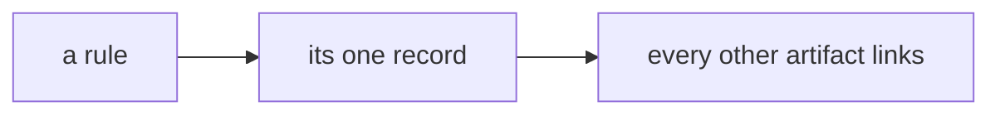

# SR-LAW-0 — L0, the records are the only source of truth

## §1 — For humans

**Every rule has one home, a record.** `CLAUDE.md`, READMEs, comments and
skills link to it; none of them carries a second copy.

**The restatement test:** could this artifact and the record disagree while
both still look correct? If yes, it is a forbidden restatement.

**Laws outrank every other record.** A sentence in a lower document that
conflicts with a law is deleted the moment it is found.



<details>
<summary><b>ASCII twin</b></summary>

```text
   a rule ---> its one record ---> every other artifact links
```

</details>

## §2 — For agents

### Context

`CLAUDE.md` and READMEs that carried copies of rules drifted from the records
they copied; two statements of one rule become two rules on the first edit.

### Decision

1. **Source.** Every rule has exactly one home, a record. Every other artifact
   — `CLAUDE.md`, a README, a comment, a skill, a diagram — **links to it and
   never restates it**. A change is made in the record first.
1a. **The records are always up to date — in the change that makes them
   wrong.** Three obligations: (i) no behaviour change lands without its record
   updated in the **same commit**; (ii) a change that touches no recorded
   decision says so — `no SR affected`, on its own line of the commit message;
   (iii) before a session ends, re-read every record you changed code under.
   (i) and (ii) are enforced by the guard; (iii) is judgment and is the only
   thing covering coherence — a record can be amended into self-contradiction
   and every check passes.
2. **Precedence.** Law records outrank every other record. A record that
   conflicts with a Law is **void in the conflicting part** — a defect, never a
   trade-off.
2a. **On contact, the conflicting sentence is deleted from the lower document**
   — never softened, footnoted, or left beside a pointer.
3. **Amendment is entrenched.** A Law changes only on Siddharth and Arpit's ruling, named in
   the record. An ordinary record a session may accept.
4. **The restatement test:** *could this artifact and the record disagree
   while both still look correct?* If yes it is a restatement and forbidden.
   If it would simply fail, it is an implementation (code naming a key) or an
   enforcement (a test, a hook) and permitted. Prose explaining *how* or *why*
   beside the code is permitted; a second statement of the rule is not.
5. **A generated view is permitted only while a test binds it byte-equal.**
   Remove the test and the view is an illegal restatement. (Not used by this
   bootstrap — tests are deferred — so `CLAUDE.md` links to the laws and
   carries none of their text.)

### Consequences

- Obligation 1a (iii) is unenforced and is the only coherence cover — backlog
  row B-006.
- `CLAUDE.md` carries pointers only, until a test can bind a generated view.

### Alternatives considered

- Rules in `CLAUDE.md` with records as commentary — rejected: that is the drift
  this law ends.

### Reference (required)

- [`scripts/sr-guard.sh`](../scripts/sr-guard.sh) — the executable form of 1a (i)–(ii).

### Veto condition

**Reopen this decision if:** a rule's normative text is found in two live files.

**How to check it:** `grep -rn "<the rule's distinctive phrase>" --include=*.md . | grep -v archive/`

---

## References

**Records** — [SR-LAWS](0001_LAWS.md) · [SR-WORK-OWNERSHIP](0058_WORK-ownership.md)

**Code**

- [`scripts/sr-guard.sh`](../scripts/sr-guard.sh)
