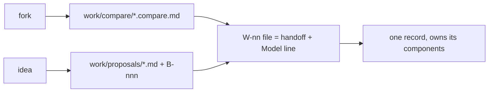

# SR-WORK-LIFECYCLE — how a feature travels

## §1 — For humans

**A fork gets a compare doc; a parked idea gets a proposal.** When work starts,
the handoff — goal, definition of done, constraints, the model that should run
it — lives in the item's own file.

**A finished feature leaves one record behind**, and that record owns the code
it produced.



<details>
<summary><b>ASCII twin</b></summary>

```text
   fork ---> compare doc --\
                            >--> W-nn file (handoff + Model) ---> one record
   idea ---> proposal -----/
```

</details>

## §2 — For agents

### Context

Handoffs kept in a separate directory drift from the item they describe; a
handoff that names no model gets executed by whichever is open.

### The lifecycle discipline (normative)

1. **On a fork, a compare doc first** — `work/compare/<name>.compare.md`:
   verdict block on top, context, options, matrix, consequences, references,
   **reopen-trigger** (a condition, not a date). Siddharth or Arpit accepts or overrides the
   verdict.
2. **On a parked idea, a proposal** — `work/proposals/<name>.md`, `status:
   proposed`, with a **graduation trigger**. Every proposal has one `B-nnn` row.
3. The design of record is the record itself, updated **before** building.
4. **The handoff lives in the item's own detail file** — context, definition
   of done, constraints, key files, edge cases, open questions. There is no
   handoff directory.
5. The prompt is paste-ready and sits beside its handoff: explore → plan →
   implement → verify.
6. **Every handoff names the model that should execute it** — a `**Model:**`
   line with one sentence of why. `**Model:** NONE — <who, and why>` is legal;
   a blank is the only wrong answer.
7. By task: **Opus** when the output quality *is* the deliverable and no test
   catches a bad one (design, debate, ambiguous diagnosis, calling a gate,
   anything touching a law) · **Sonnet** for a written definition of done with
   checks to verify it · **Haiku** for mechanical bulk edits with an exact rule.
8. When borderline, say Opus and say why it was close.
9. One feature, one record, written from `records/TEMPLATE.md` on completion,
   with its components added to the ownership table in the same change.
10. Every rule, record and material decision carries a reference.
11. An implemented proposal is archived in the change that writes its record.

### Consequences

- **Enforced today:** nothing — every rule here is judgment.
- Decision 9 is what retires `W-01`'s placeholder ownership, one component at
  a time.

### Alternatives considered

- A separate `handoffs/` directory — rejected: two files per item, and the
  second goes stale.

### Reference (required)

- [`records/TEMPLATE.md`](TEMPLATE.md) · [`work/open/README.md`](../work/open/README.md)

### Veto condition

**Reopen this decision if:** an item file in `work/open/` has no `**Model:**` line.

**How to check it:** `grep -L '^\*\*Model:\*\*' work/open/W-*.md`

---

## References

**Records** — [SR-WORK-OPEN-QUEUE](0051_WORK-open-queue.md) · [SR-WORK-BACKLOG](0052_WORK-backlog.md)

**Project docs**

- [`work/compare/README.md`](../work/compare/README.md) · [`work/proposals/README.md`](../work/proposals/README.md)
