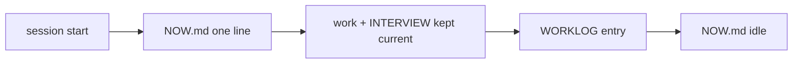

# SR-WORK-SESSION — what a session owes

## §1 — For humans

**Every session leaves the next one warmer.** It appends a worklog entry, keeps
`INTERVIEW.md` true while it works, and writes one line to `NOW.md` so a session
that dies mid-task leaves a note.

**A failure seen twice becomes a check**, in the change that records it.



<details>
<summary><b>ASCII twin</b></summary>

```text
   start ---> NOW.md ---> work + INTERVIEW current ---> WORKLOG entry ---> NOW.md idle
```

</details>

## §2 — For agents

### Context

A cold session that has to rediscover state spends its budget on archaeology;
a session that dies silently leaves a mystery.

### The session discipline (normative)

1. **Every session appends one worklog entry before it ends** —
   `work/WORKLOG.md`: asked, done, decided or left open, the single next step.
   A chat-only session counts.
2. The worklog is append-only, newest on top; a wrong old entry is corrected
   by a new one.
3. **`work/INTERVIEW.md` is kept current DURING the session.** Four
   maintained sections: state of play · in flight and the immediate next step ·
   standing constraints · lessons learned.
4. **`work/IMPLEMENTATION.md` is the evidence store** the queue reconciles
   against. A row is earned by landing, never by being planned.
5. **`work/NOW.md` carries one line, overwritten.** A session that dies
   mid-task leaves a note, not a mystery. `idle` when nothing is in flight.
6. **Announce every transition in one line — a marker, never a summary.**
   `→ W-12: building the parser` on start; `✓ W-12 · → W-13: …` on finish.
   A finish with no next is a stop, and a stop is its own sentence.
7. Keep a todo list for anything with more than two steps, current during the
   work.
8. **Ten lines or fewer unless more was asked for, and lead with the answer.**
9. Never summarise work you just did — the diff showed it. No closing offers.
10. **Concurrent sessions are real.** Re-derive `git status` right before
    staging; re-apply your `work/*.md` edits right before committing; commit
    with explicit pathspecs when the index carries another session's work.
11. **Ground truth over prose.** Before any status claim, check `git log`,
    the code, or a command that reproduces it.
12. Say what you are running, and when, to anyone sharing the machine.
13. 🔴 **Two strikes → a gate.** A failure class the worklog records twice
    becomes a check — a hook, a script, or (once tests exist) a test — **in the
    same change that records the second occurrence.**
14. The worklog is cut at each major release into `archive/worklog/`.

### Consequences

- **Enforced today:** decision 5, nudged once per turn by
  `.claude/hooks/require-progress.sh` when files changed and `NOW.md` did not.
- **Judgment today:** every other decision.

### Alternatives considered

- An end-of-session report only — rejected: a session that dies never writes it.

### Reference (required)

- [`.claude/hooks/require-progress.sh`](../.claude/hooks/require-progress.sh)
- [`work/WORKLOG.md`](../work/WORKLOG.md) · [`work/INTERVIEW.md`](../work/INTERVIEW.md)

### Veto condition

**Reopen this decision if:** a commit lands on a day with no `work/WORKLOG.md`
entry for that date.

**How to check it:** `git log --format=%ad --date=short | sort -u` against `grep '^## ' work/WORKLOG.md`

---

## References

**Records** — [SR-WORK-OPEN-QUEUE](0051_WORK-open-queue.md) · [SR-WORK-DOCS](0055_WORK-docs.md)

**Code**

- [`.claude/hooks/require-progress.sh`](../.claude/hooks/require-progress.sh)

**Project docs**

- [`work/WORKLOG.md`](../work/WORKLOG.md) · [`work/INTERVIEW.md`](../work/INTERVIEW.md) · [`work/NOW.md`](../work/NOW.md) · [`work/IMPLEMENTATION.md`](../work/IMPLEMENTATION.md)
