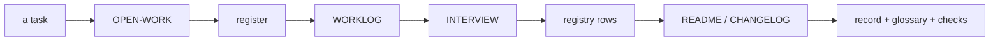

# SR-WORK-DOCS — the documentation contract

## §1 — For humans

**Docs are short points, not walls.** Lead with the takeaway; tables for
comparisons; split any wall you touch.

**`docs/` is what the project is; `work/` is what is happening to it.** Every
task updates a fixed list of documents, in a fixed order, before it is done.



<details>
<summary><b>ASCII twin</b></summary>

```text
   task -> OPEN-WORK -> register -> WORKLOG -> INTERVIEW -> registry rows
        -> README/CHANGELOG -> record + glossary + checks
```

</details>

## §2 — For agents

### Context

Docs updated "afterwards" are not updated; steering files edited silently
change every later session's behaviour without anyone noticing.

### The documentation discipline (normative)

1. No large paragraphs: 3–4 lines, one idea per point.
2. Roomy: blank lines, tables for comparisons, headings.
3. Lead each point with the takeaway, bolded where it helps scanning.
4. Fix form on contact — a wall of text you touch, you split.
5. Chat answers follow the same rule.
6. **An agent may edit the agent-steering files directly**, `CLAUDE.md`
   included — no proposal step.
7. Under two obligations, both judgment: **(a) say it out loud** — a change to
   `CLAUDE.md` is named in the session output and the worklog entry; **(b) a
   ruling of Siddharth's or Arpit's, or a fact** — never latitude you were not given.
8. Statements of fact are exempt from every ceremony: fixed on contact.
9. The split is `docs/` (what the project *is*) and `work/` (what is
   *happening* to it). `work/README.md` is the map.
10. **Every task updates, before it is done, in this order:** (1)
    `work/OPEN-WORK.md` · (2) the register · (3) `work/WORKLOG.md` · (4)
    `work/INTERVIEW.md` · (5) the registry row of any doc touched · (6)
    `README.md` / `CHANGELOG.md` when public-facing · (7) the relevant record,
    the glossary for any new term, every check the change needs.
11. The registry's rules are `SR-WORK-REGISTRY`'s.
12. Every relative link in a live document resolves (judgment until a link
    test exists).
13. Durable repo-wide knowledge is folded into `CLAUDE.md` concisely, as a
    pointer to its record.

### Consequences

- **Enforced today:** nothing — every decision here is judgment.
- Decision 12 becomes a gate once a link test exists.

### Alternatives considered

- A proposal step before editing `CLAUDE.md` — rejected: it slows the fixes
  that matter most; saying it out loud (7a) is the cheaper control.

### Reference (required)

- [`work/README.md`](../work/README.md) — the map decision 9 names.
- [SR-WORK-REGISTRY](0060_WORK-registry.md) §3 — the registry decision 10 (5) bumps.

### Veto condition

**Reopen this decision if:** a change to `CLAUDE.md` lands with no worklog
entry naming it.

**How to check it:** `git log --format='%h %ad' --date=short -- CLAUDE.md` against `work/WORKLOG.md`

---

## References

**Records** — [SR-WORK-REGISTRY](0060_WORK-registry.md) · [SR-WORK-SESSION](0054_WORK-session.md)

**Project docs**

- [`CLAUDE.md`](../CLAUDE.md) · [`work/README.md`](../work/README.md) · [`docs/GLOSSARY.md`](../docs/GLOSSARY.md)
