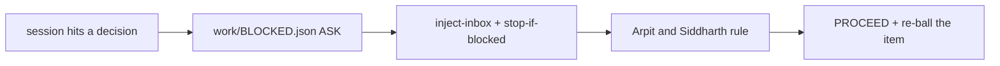

# SR-WORK-BLOCKERS — a blocker is a file, not a remark

## §1 — For humans

**When a session cannot go on without Arpit and Siddharth, it writes `work/BLOCKED.json` and
stops.** The file names the minimum question and what can safely be done
meanwhile.

**Hooks make it impossible to miss:** every prompt is prefixed with the open
blocker and the inbox, and a turn cannot end while the blocker is unsurfaced.



<details>
<summary><b>ASCII twin</b></summary>

```text
   decision needed ---> BLOCKED.json ASK ---> hooks surface it ---> ruling ---> PROCEED + re-ball
```

</details>

## §2 — For agents

### Context

A blocker mentioned in passing is a blocker nobody reads; an agent that guesses
past a decision produces work that has to be undone.

### The blockers discipline (normative)

1. **A blocker is a file, not a remark.** The moment you cannot proceed
   without Arpit and Siddharth, write `work/BLOCKED.json` and stop.
2. Shape:
   ```json
   {"decision":"ASK","reason":"one line","questions":["the minimum question"],
    "safe_alternative":"what you can do meanwhile, or \"\"","surfaced":false,"filed":"YYYY-MM-DD"}
   ```
3. `decision` takes exactly four values — `ASK` (the decider can unblock you) ·
   `REFUSE` (disallowed or unsafe) · `UNKNOWN` (out of scope to answer
   reliably) · `PROCEED` (nothing is blocked).
4. `questions` carries the **minimum** question.
5. `safe_alternative` is what can be done meanwhile — never a guess at what the decider
   would have said.
6. **Do not work around a blocker.** Say it, set `surfaced: true`, stop.
7. Three hooks enforce it: `UserPromptSubmit` injects the blocker and the
   inbox into every prompt (`inject-inbox.sh`); `Stop` refuses to end a turn
   while a blocker is unsurfaced, three times, then relents
   (`stop-if-blocked.sh`); `PreToolUse` on writes is a **per-asset** lock
   (`session-lock.sh`, TTL 900 s).
8. The `Stop` hook relents after three refusals deliberately — a hook that
   never relents is a hang. Taking the third exit while still blocked breaks
   rule 6.
9. The lock is per asset, not per session; two sessions are expected.
10. When Arpit and Siddharth rule, the file is set back to `PROCEED` with the ruling as
    `reason` and the resulting item re-balled in the same change.

### Consequences

- **Enforced today:** decisions 1, 6 and 9 through the three hooks of decision 7.
- **Judgment today:** decisions 4, 5, 8 and 10. The third-exit escape is
  accepted cost B-007.

### Alternatives considered

- A blocker as a queue row only — rejected: nothing forces a session to read
  the queue before ending a turn.

### Reference (required)

- [`.claude/hooks/inject-inbox.sh`](../.claude/hooks/inject-inbox.sh)
- [`.claude/hooks/stop-if-blocked.sh`](../.claude/hooks/stop-if-blocked.sh)
- [`.claude/hooks/session-lock.sh`](../.claude/hooks/session-lock.sh)

### Veto condition

**Reopen this decision if:** `work/BLOCKED.json` is not valid JSON or carries
a `decision` outside the four values.

**How to check it:** `jq -e '.decision | IN("ASK","REFUSE","UNKNOWN","PROCEED")' work/BLOCKED.json`

---

## References

**Records** — [SR-WORK-OPEN-QUEUE](0051_WORK-open-queue.md) · [SR-WORK-SESSION](0054_WORK-session.md)

**Code**

- [`.claude/hooks/inject-inbox.sh`](../.claude/hooks/inject-inbox.sh) · [`.claude/hooks/stop-if-blocked.sh`](../.claude/hooks/stop-if-blocked.sh) · [`.claude/hooks/session-lock.sh`](../.claude/hooks/session-lock.sh) · [`.claude/settings.json`](../.claude/settings.json)

**Project docs**

- [`work/BLOCKED.json`](../work/BLOCKED.json)
