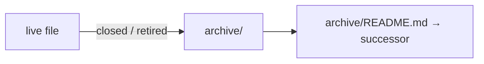

# SR-WORK-ARCHIVE — one archive; named, never cited

## §1 — For humans

**Nothing closed is deleted — it moves to `archive/`.** The archive mirrors the
live tree and its README maps every archived file to its live successor.

**Archived means history, not evidence.** You may mention an archived doc; you
may not use it to prove anything is true now.



<details>
<summary><b>ASCII twin</b></summary>

```text
   live file --closed/retired--> archive/<same path> ---> archive/README.md -> successor
```

</details>

## §2 — For agents

### Context

Several "old/" directories scattered through a repo get cited as if live, and
nobody can tell which version is authoritative.

### The archive discipline (normative)

1. Exactly one archive: `archive/` at the repo root.
2. Anything archived is **moved** there into a directory mirroring where it
   came from (`archive/open/`, `archive/records/`, `archive/compare/`, …).
3. Every archived document gets a row in `archive/README.md` naming its live
   successor, or saying it has none.
4. An archived document may be **named** in prose, with a link.
5. It may **never back a live claim** — nothing guarantees it was not
   overwritten after retirement.
6. When repointing a citation away from an archived doc, point at the live
   successor; never just delete the link.
7. If an archived doc was a claim's only support, the claim needs new
   grounding.
8. A superseded record is never archived (rewritten or deleted); a **retired**
   record is archived (L1).
9. Links inside `archive/` are never repaired; the tree is frozen.

### Consequences

- **Enforced today:** nothing — a second `archive/` directory is backlog row
  B-005.
- The archive is created empty at setup; nothing was archived by setup itself
  (Arpit and Siddharth's instruction, 2026-10-13).

### Alternatives considered

- Rely on git history for closed items — rejected: closed items' files are the
  most useful context a later session has, and history is not browsed.

### Reference (required)

- [`archive/README.md`](../archive/README.md) — the map.

### Veto condition

**Reopen this decision if:** a second directory named `archive` exists anywhere
in the tree.

**How to check it:** `find . -type d -name archive -not -path ./archive -not -path './node_modules/*'`

---

## References

**Records** — [SR-LAW-1](0003_LAW-1-retired-records-archived.md) · [SR-WORK-OPEN-QUEUE](0051_WORK-open-queue.md)

**Project docs**

- [`archive/README.md`](../archive/README.md)
